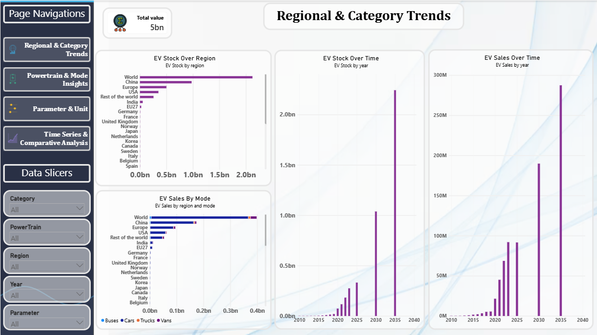

# Global EV Analytics Dashboard (Power BI)

An interactive 4-page Power BI dashboard that explores how electric vehicles have grown worldwide, using the IEA Global EV Data 2024 dataset.

## Objective

To answer three questions:
- How fast has EV adoption grown since 2010?
- Which regions account for most of the EV stock?
- How is the mix between battery electric (BEV) and plug-in hybrid (PHEV) vehicles changing?

## Dataset

- **Source:** IEA Global EV Data 2024
- **Size:** 12,654 records covering 54 regions (50 countries plus 4 aggregates: World, Europe, EU27, Rest of the world)
- **Period:** 2010 to 2023 is historical data. 2024 to 2035 is IEA projection (STEPS and APS scenarios)
- **Key fields:** region, category, parameter, mode, powertrain, year, unit, value

## Tools

Power BI, Power Query (data cleaning), DAX (measures)

## Dashboard Pages

| Page | What it shows |
|------|---------------|
| Regional & Category Trends | EV stock and sales by region, by mode, and over time |
| Powertrain & Mode Insights | BEV, PHEV and FCEV split by vehicle mode and over time |
| Parameter & Unit Analysis | Sales vs stock, energy consumption, and a region-by-parameter table |
| Time Series & Comparative Analysis | Global stock trend, top regions, BEV vs PHEV, cumulative stock |

## Key Findings

*(Historical data, cars only, BEV + PHEV)*

- Global EV car stock grew from about **20,000 in 2010 to 40 million in 2023**.
- **China holds about 54%** of the 2023 stock (21.8M). China, Europe and the USA together hold about **95%**.
- EVs went from **2.6% of global car sales in 2019 to 18% in 2023**.
- BEVs make up about **70%** of global EV car stock in 2023.

## DAX Measures

- **EV Stock:** total EV stock for the selected filters
- **EV Sales:** total EV sales for the selected filters
- **Cumulative EV Stock:** running total of EV stock over time

## Interactivity

- Slicers for Category, Powertrain, Region, Year and Parameter on every page
- Navigation buttons to move between pages

## Notes on the Data

- Stock figures should be viewed with **Category = Historical** to avoid mixing in projection scenarios.
- Aggregates such as World and Europe overlap with individual countries, so exclude them when comparing countries.
- Charts that extend past 2023 show IEA projections, not recorded data.

## Files

- `project.pbix`: the Power BI report
- `IEA Global EV Data 2024.csv`: the source dataset
- `Regional-analysis.png`, `Powertrain&Mode.png`, `Parameter&Unit.png`, `TimeSeries&Comparitive.png`: screenshots of each dashboard page

## Author

**Sarthak Deshpande**
[LinkedIn](https://linkedin.com/in/sarthakdeshpande) | [GitHub](https://github.com/Sarthak16035)
